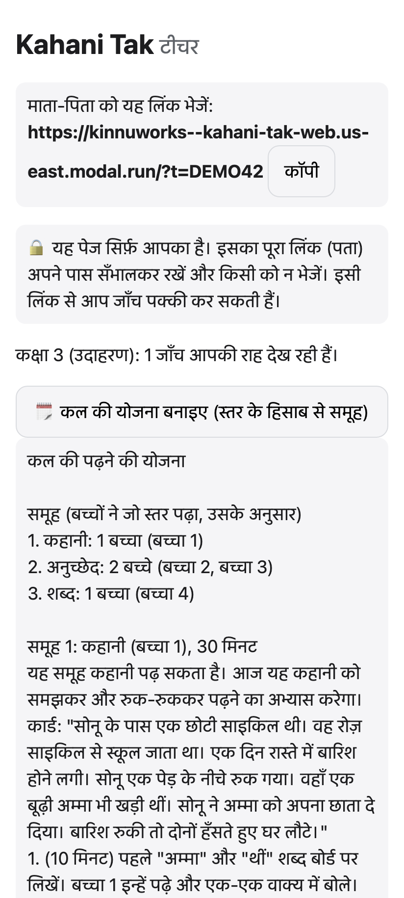

# Kahani Tak

A parent's phone listens to a child read one Hindi card aloud, marks every word right or wrong, and says which ASER reading level the child reached and what to practise tonight. Results the machine isn't sure of go to the child's teacher, who listens and confirms.

It needs agentic AI because the checking runs as a chain of decisions: a speech model that writes down what the child actually said (AI4Bharat IndicConformer, not an LLM, which would quietly correct a misread word), code that applies ASER's rules and picks the next card, and a class-planner agent, built and evaluated in AgentFoundry (the hackathon's agent IDE), that reads a class's confirmed levels through its tools and writes tomorrow's level-wise groups and activities for the teacher.


<sub>Recorded by our automated browser test with a synthetic voice. No child's voice is published.</sub>



<sub>Teacher side: a borderline reading waiting for the teacher, and the agent's real plan for the demo class (synthetic voices).</sub>

**Live app:** https://kinnuworks--kahani-tak-web.us-east.modal.run
**Live impact numbers:** https://kinnuworks--kahani-tak-web.us-east.modal.run/impact

### Try it in 30 seconds
1. Open the live app on a phone, tick the consent box, tap **शुरू करें** (Start).
2. Tap the mic and read the paragraph aloud (or have a child read it). Tap again when done.
3. See each word in green or red, then the next card. After one or two cards you get the level and tonight's 5-minute practice.
4. Teacher side, with a demo class of synthetic voices: [open the demo teacher page](https://kinnuworks--kahani-tak-web.us-east.modal.run/teacher/UYPCDN#k=YjTPqrg3hP7WoPFbX1Y0wxSdaG3ZEfVKTUVzG3dp2NY). Play a reading, tap a word, confirm, or press **कल की योजना बनाइए** to have the agent plan tomorrow.

---

## Why this matters
- In rural India, 27.0% of children in Class 3 can read a Class 2 text (ASER 2024, all schools, [slide 4](https://asercentre.org/wp-content/uploads/2022/12/ASER-2024-All-India-ppt-Jan-27-11am.pdf)). In Class 5 it is 48.8% (slide 6).
- 10.44 crore children are enrolled in Classes 1 to 5 (UDISE+ 2024-25, reported by [ThePrint](https://theprint.in/india/education/shift-in-demography-is-hitting-indian-classrooms-school-enrolment-has-fallen-to-7-yr-low/2731023)).
- Teaching children at the level they actually read, rather than their class, gave language gains of 0.15 SD in Haryana and 0.70 SD in Uttar Pradesh (Banerjee et al., [NBER w22746](https://www.nber.org/papers/w22746)). That needs each child's level first, which today takes a trained person sitting with each child.

## How it works
1. **Card.** The check starts with a 4-sentence paragraph, as ASER does. Cards are our own, in ASER's format (5 letters, 5 words, a 4-sentence paragraph, a 7 to 10 sentence story), in four sets so re-checks don't repeat.
2. **Hear.** The phone records the child. On the server, AI4Bharat's IndicConformer (MIT licence) transcribes it with CTC decoding: it writes the sounds it heard.
3. **Count.** Plain code lines the transcript up with the card and counts mistakes by ASER's rules: letters and words pass at 4 of 5, a paragraph or story with 3 or fewer mistakes. Hindi spellings that sound the same (वहाँ/वहां, गये/गए) are not counted as mistakes.
4. **Next step.** Paragraph passed: the story. Failed: words, then letters. The final level lights up on a five-step ladder with a 5-minute practice for tonight.
5. **Teacher.** Every word or letter result, and every paragraph or story within one mistake of the pass line, goes to the teacher's queue. The teacher plays it, taps any word the machine got wrong, and confirms. The parent's screen updates.
6. **Plan.** The class-planner agent reads the class only through its tools (class summary, most-missed words, practice cards), groups children by level, and writes a 30-minute plan per group in Hindi. It cannot change a level, and refers to children only as "बच्चा 1", "बच्चा 2".

## How accurate is it?
We tested the hearing-and-counting step on 110 real children's paragraph and story readings from Pratham's ReadNet dataset (children aged 5 to 16 reading ASER texts, transcribed by ASER's experts, [CC-BY-NC-4.0](https://huggingface.co/datasets/PrathamOrgAI/ReadNet)). IndicConformer matched the experts' pass/fail on 86 of 110. It placed 1 child too high and 23 too low, mostly children right at the 3-mistake line. That is why borderline results go to the teacher. Single words and letters were much less reliable, so all of those go to the teacher too. An LLM transcriber we tried rewrote a reading with 3 wrong words as a perfect reading, so we don't use one for hearing.

## AgentFoundry
- Built in the AgentFoundry IDE.
- Agent Studio: `.codenow/agent-studio/agents/kahani-class-planner.json` registers the live agent (invocation URL, header auth, tools), with its versioned prompt and an eval suite of 7 cases that runs in AF's Eval tab (also in `check.sh`).

## Privacy
No child names are asked for. A parent confirms they are the parent and over 18 before recording. Recordings are deleted once the teacher has checked them, or after 7 days. Teacher actions need a secret teacher key; the class code in the parents' link can't open the queue.

## Run it yourself
```
uv venv --python 3.12 .venv && VIRTUAL_ENV=.venv uv pip install fastapi "uvicorn[standard]" python-multipart pytest httpx soundfile numpy onnxruntime torch torchaudio anthropic
# model files: huggingface.co/ai4bharat/indic-conformer-600m-multilingual (accept its terms), into ~/models/indic-conformer
.venv/bin/uvicorn kahani.server:app --port 8765
```
Needs `ffmpeg`. Set `ANTHROPIC_API_KEY` for the class planner. `./check.sh` runs every test: scoring rules, the real speech model on test clips with planted mistakes, the API, the agent eval, and the parent and teacher flows in a real browser.

## Credits and licence
MIT licence (see LICENSE). Speech model: AI4Bharat IndicConformer (MIT). Card format and levels: ASER Centre's published assessment tasks; the card texts are our own. Accuracy test data: Pratham ReadNet (used for evaluation only, not shipped).
